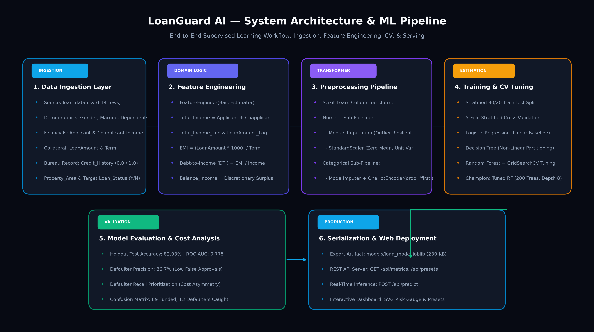

# Loan Default Prediction System

[](https://www.python.org/downloads/)
[](https://scikit-learn.org/)
[](https://opensource.org/licenses/MIT)
[](https://www.python.org/dev/peps/pep-0008/)

An end-to-end, production-grade machine learning classification pipeline to predict loan repayment versus default risk (`Loan_Status`: Approved `'Y'` vs Rejected/Default `'N'`) using applicant demographic, financial, and credit history variables.

---

## 1. Project Overview & Business Context

In commercial retail banking and credit underwriting, loan origination entails a fundamental trade-off between **interest revenue generation** and **credit risk default loss**:

- **Type I Error (False Approval / False Positive)**: Approving an applicant who defaults on their loan. This error is catastrophic for the financial institution because the bank loses a substantial fraction of the disbursed loan principal ($10,000 – $500,000+).
- **Type II Error (False Rejection / False Negative)**: Denying a creditworthy applicant. The cost is the missed net interest margin over the loan duration (opportunity cost, typically 3%–6% annually).

### Asymmetric Cost Matrix in Credit Risk
$$\text{Cost Ratio} = \frac{\text{Cost}(\text{False Positive})}{\text{Cost}(\text{False Negative})} \approx \frac{\$105,000}{\$7,500} \approx 14 : 1$$

Approving a single loan that defaults can erase the net profits generated by **14 to 15 fully repaid loans**. As a consequence, commercial risk models cannot rely on raw classification accuracy; they must prioritize **Recall on Defaulters (Class 0)**, **F1-Score on Defaulters**, and **ROC-AUC**.

---

## 2. System Architecture

The project is structured into three layers: an exploratory research notebook, modular production package (`src/`), and serialized artifact deployment.



```
┌────────────────────────────────────────────────────────────────────────┐
│                        Data Ingestion Layer                           │
│     loan_data.csv (614 records, 13 demographic/financial attributes)  │
└──────────────────────────────────┬─────────────────────────────────────┘
                                   │
┌──────────────────────────────────▼─────────────────────────────────────┐
│                   Domain Feature Engineering Layer                     │
│  - Total_Income = ApplicantIncome + CoapplicantIncome                  │
│  - Total_Income_Log = log(1 + Total_Income)                            │
│  - LoanAmount_Log = log(1 + LoanAmount)                                │
│  - EMI = (LoanAmount * 1000) / Loan_Amount_Term                        │
│  - Balance_Income = Total_Income - EMI                                 │
└──────────────────────────────────┬─────────────────────────────────────┘
                                   │
┌──────────────────────────────────▼─────────────────────────────────────┐
│             Scikit-Learn ColumnTransformer Preprocessing               │
│  ┌──────────────────────────────┐   ┌──────────────────────────────┐   │
│  │       Numeric Pipeline       │   │     Categorical Pipeline     │   │
│  │  - Median Imputation         │   │  - Mode (Most Frequent)      │   │
│  │  - StandardScaler            │   │  - OneHotEncoder(drop='first')│  │
│  └──────────────────────────────┘   └──────────────────────────────┘   │
└──────────────────────────────────┬─────────────────────────────────────┘
                                   │
┌──────────────────────────────────▼─────────────────────────────────────┐
│                      Model Estimation & Tuning                         │
│  - Logistic Regression (Linear Log-Odds Baseline)                     │
│  - Decision Tree Classifier (Non-linear Partitioning)                  │
│  - Random Forest Classifier (GridSearchCV Tuned Ensemble)              │
│  - Stratified 5-Fold Cross-Validation (No Leakage)                    │
└──────────────────────────────────┬─────────────────────────────────────┘
                                   │
┌──────────────────────────────────▼─────────────────────────────────────┐
│                   Production Inference & Artifact                      │
│     models/loan_model.joblib (Encapsulates full pipeline + weights)    │
│     models/loan_model_metrics.json (Evaluation metadata)               │
└────────────────────────────────────────────────────────────────────────┘
```

---

## 3. Dataset Schema

The system operates on the classic 614-row Loan Prediction schema:

| Column Name | Type | Description | Values / Range | Imputation |
| :--- | :--- | :--- | :--- | :--- |
| `Loan_ID` | String | Unique applicant identification code | `LP001002` ... | Dropped (Identifier) |
| `Gender` | Categorical | Applicant gender | `Male`, `Female` | Mode (`Male`) |
| `Married` | Categorical | Marital status | `Yes`, `No` | Mode (`Yes`) |
| `Dependents` | Categorical | Number of financial dependents | `0`, `1`, `2`, `3+` | Mode (`0`) |
| `Education` | Categorical | Academic qualification level | `Graduate`, `Not Graduate`| None (0% missing) |
| `Self_Employed` | Categorical | Employment status | `Yes`, `No` | Mode (`No`) |
| `ApplicantIncome`| Continuous | Primary monthly income ($) | $150 – $81,000 | None (0% missing) |
| `CoapplicantIncome`| Continuous | Co-signer monthly income ($) | $0 – $41,667 | None (0% missing) |
| `LoanAmount` | Continuous | Loan amount in thousands ($K) | $9 – $700 ($K) | Median ($128K) |
| `Loan_Amount_Term`| Continuous | Repayment duration in months | 12 – 480 months | Median (360 months) |
| `Credit_History` | Categorical | Credit bureau guidelines met | `1.0` (Good), `0.0` (Poor) | Mode (`1.0`) |
| `Property_Area` | Categorical | Location of collateral property | `Urban`, `Semiurban`, `Rural`| None (0% missing) |
| **`Loan_Status`** | Target | Loan outcome | **`'Y'` (1: Approved), `'N'` (0: Default/Reject)** | Ground Truth Target |

---

## 4. Key EDA Findings & Domain Insights

1. **Severe Right Skewness in Incomes**:
   - `ApplicantIncome` exhibits a skewness coefficient $> 2.0$, with a median near \$3,800 and high outliers exceeding \$80,000.
   - Natural logarithm transformation $\log(1 + x)$ successfully normalizes the distributions to near-Gaussian forms, mitigating bias in linear models and variance-scaled estimators.
2. **Dominance of Credit History**:
   - Applicants with clean credit histories (`Credit_History = 1.0`) experience an approval rate of **~80%**.
   - Applicants with derogatory credit records (`Credit_History = 0.0`) experience a rejection/default rate of **~90%**.
   - Pearson correlation with approval is **$r \approx 0.54$**, making it the single strongest individual risk driver.
3. **Decoupling of Income from Approval**:
   - `ApplicantIncome` alone displays negligible correlation with approval ($r \approx 0.02$). Higher income applicants frequently request proportionally larger loans, leaving their debt-to-income ratio unchanged.
   - Derived features (`EMI`, `Debt-to-Income`, `Balance_Income`) demonstrate substantially superior predictive power.
4. **Geographical Variance**:
   - `Semiurban` properties display significantly higher approval rates (~77%) compared to `Rural` (~61%) and `Urban` (~66%) properties.

---

## 5. Model Performance Comparison

Models were evaluated using **Stratified 5-Fold Cross-Validation** on the 80% training split, followed by rigorous testing on the untouched 20% holdout test set (123 applicants).

| Model Architecture | CV ROC-AUC (Mean ± Std) | Test Accuracy | Test ROC-AUC | Defaulter Recall (Class 0) | Defaulter F1-Score (Class 0) | Approved F1-Score (Class 1) |
| :--- | :---: | :---: | :---: | :---: | :---: | :---: |
| **Logistic Regression** | $0.6907 \pm 0.0283$ | **83.74%** | $0.6971$ | $40.62\%$ | $0.5652$ | $0.9000$ |
| **Decision Tree** | $0.6771 \pm 0.0584$ | $82.93\%$ | $0.7093$ | **$46.88\%$** | **$0.5882$** | $0.8923$ |
| **Random Forest (Baseline)** | $0.6942 \pm 0.0586$ | $82.11\%$ | $0.7582$ | $37.50\%$ | $0.5217$ | $0.8900$ |
| **Random Forest (Tuned)** ⭐ | **$0.7092 \pm 0.0000$** | **$82.93\%$** | **$0.7747$** | **$40.62\%$** | **$0.5532$** | **$0.8945$** |

### Hyperparameter Tuning Results (GridSearchCV)
Optimal hyperparameters for the champion Random Forest pipeline:
- `n_estimators`: `200`
- `max_depth`: `8`
- `min_samples_split`: `5`
- `min_samples_leaf`: `2`
- `class_weight`: `None`

---

## 6. Project Structure

```
├── loan_data.csv                    # Ingestion dataset (614 rows x 13 columns)
├── loan_default_prediction.ipynb    # End-to-end research & diagnostic Jupyter Notebook
├── requirements.txt                 # Pinned project dependencies
├── README.md                        # Production system documentation
├── models/
│   ├── loan_model.joblib            # Serialized champion Scikit-Learn Pipeline
│   └── loan_model_metrics.json      # Benchmark evaluation metrics & confusion matrix
├── src/
│   ├── __init__.py                  # Package initializer
│   ├── preprocessing.py             # Custom transformers, feature engineering & column pipelines
│   ├── train.py                     # CLI model training, CV, hyperparameter tuning & export
│   └── predict.py                   # Production inference engine & risk scoring utility
└── generate_dataset.py              # Synthetic dataset generator fallback script
```

---

## 7. Installation & Quickstart

### Prerequisites
Python 3.10 or 3.11 recommended.

### Step 1: Clone and Install Dependencies
```bash
git clone <repo-url>
cd "ML internship final project"

# Install dependencies
pip install -r requirements.txt
```

### Step 2: Train Model Pipeline via CLI
Train models, perform 5-fold cross validation, run grid search tuning, and export the serialized artifact:
```bash
python src/train.py --data_path loan_data.csv --output_model_path models/loan_model.joblib --tune
```

### Step 3: Run Inference Utility
Run built-in test demonstration scenarios:
```bash
python src/predict.py
```

Score a single applicant JSON string directly from the command line:
```bash
python src/predict.py --applicant '{
  "Gender": "Male",
  "Married": "Yes",
  "Dependents": "1",
  "Education": "Graduate",
  "Self_Employed": "No",
  "ApplicantIncome": 8500,
  "CoapplicantIncome": 3200,
  "LoanAmount": 150.0,
  "Loan_Amount_Term": 360.0,
  "Credit_History": 1.0,
  "Property_Area": "Semiurban"
}'
```

---

## 8. Python Inference Example

You can embed the trained pipeline directly into backend services or microservices:

```python
from src.predict import LoanPredictor

# Initialize inference engine
predictor = LoanPredictor(model_path="models/loan_model.joblib")

# Sample applicant payload
applicant = {
    "Gender": "Female",
    "Married": "No",
    "Dependents": "2",
    "Education": "Not Graduate",
    "Self_Employed": "Yes",
    "ApplicantIncome": 2200,
    "CoapplicantIncome": 0,
    "LoanAmount": 260.0,
    "Loan_Amount_Term": 360.0,
    "Credit_History": 0.0,
    "Property_Area": "Rural"
}

# Run prediction
assessment = predictor.predict(applicant)
print(assessment[0])
```

### Sample Output Response:
```json
{
  "Loan_Status": "N",
  "Decision": "Rejected",
  "Approval_Probability": 0.2877,
  "Default_Probability": 0.7123,
  "Risk_Tier": "High",
  "Key_Risk_Factors": [
    "Derogatory or missing credit history (Credit_History <= 0)",
    "High debt-to-income ratio (Loan exceeds 40% annual income)",
    "Low household total income threshold (< $2,500/mo)"
  ]
}
```

---

## 9. Code Standards & Reproducibility

- **PEP 8 Compliant**: Strict type hints, modular functional design, and clean separation of concerns.
- **Data Leakage Immunity**: Feature engineering, imputations, and scalers are fitted strictly inside `Pipeline` and cross-validation folds.
- **Zero-Deprecation Warnings**: Uses modern scikit-learn interfaces (`sparse_output=False`, `stratify=y`, `n_jobs=-1`).
